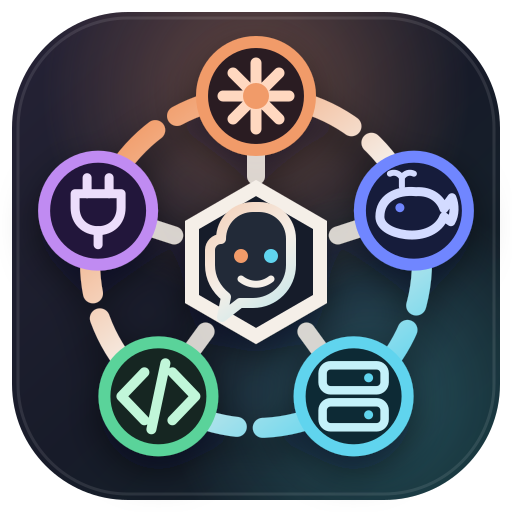
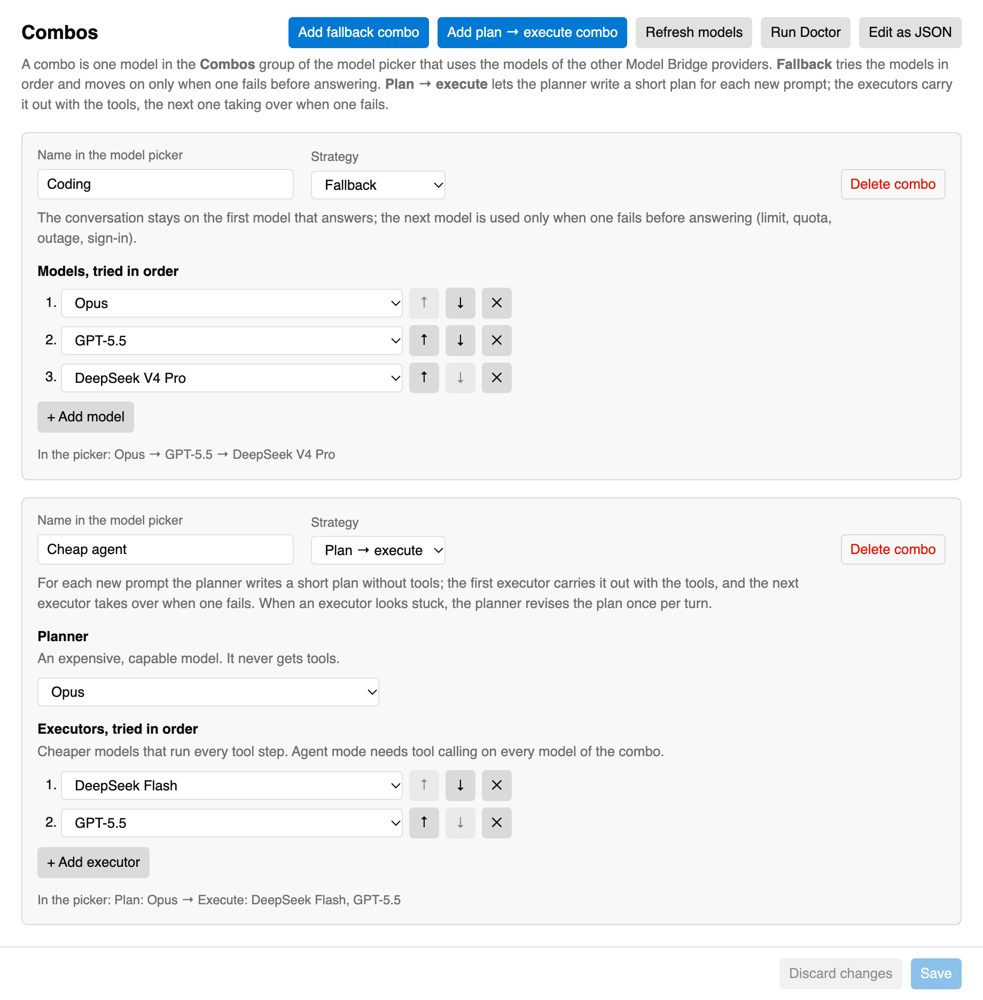

<div align="center">
  

  <h1>Model Bridge for Copilot</h1>

  <p><strong>Claude subscriptions, ChatGPT Codex, DeepSeek, LM Studio, Ollama, llama.cpp, vLLM, and other OpenAI-compatible models in native VS Code Chat — on their own or combined.</strong></p>

  <a href="https://boosty.to/rtm00"></a>
</div>

Model Bridge for Copilot is a multi-provider VS Code Language Model Provider. It keeps the native Chat and Agent experience while letting you choose between a signed-in Claude Code account, ChatGPT Codex, models running locally in LM Studio, the DeepSeek API, and any OpenAI-compatible server such as Ollama, llama.cpp, or vLLM.

Combos join these models into one picker entry: a **fallback** that moves to the next provider when one hits a rate limit, runs out of quota, or goes down, and a **plan → execute** pair where an expensive model plans each prompt and a cheaper one does the tool steps.

> This is an independent community extension. It is not affiliated with or endorsed by Anthropic, OpenAI, DeepSeek, Microsoft, or LM Studio.


## Providers

| Provider | Authentication | Models and transport |
|---|---|---|
| **Claude** | Official Claude Code browser sign-in; no API key handled by the extension | Every model Claude Code offers the account — aliases such as Opus and Sonnet plus specific versions — through safe-mode `stream-json` |
| **Codex** | ChatGPT browser sign-in with multi-account support, stored in VS Code SecretStorage | Automatic Codex model discovery with HTTP/WebSocket Responses parity |
| **DeepSeek** | DeepSeek API key in VS Code SecretStorage, bound to the API URL | DeepSeek Flash and V4 Pro with 1M context, thinking effort, tool calls, context caching, and balance in the status bar |
| **LM Studio** | No authentication by default; optional local server token in VS Code SecretStorage | Native model metadata plus OpenAI-compatible streaming chat and function tools |
| **OpenAI-Compatible** | Optional API token per endpoint in VS Code SecretStorage, bound to the endpoint URL | Ollama, llama.cpp server, vLLM, or any `/v1/chat/completions` server, with per-server metadata discovery |

Each provider has its own model-picker group and management command. Run **Model Bridge: Manage Providers** to open the unified entry point. A **Combos** group can join models from these providers into one picker entry: a fallback to the next model when one is rate limited or out of quota, or an expensive planner with a cheaper executor ([details](#combos)).

## Highlights

- Native VS Code Chat and Agent integration.
- Streaming text, thinking/reasoning, tool calls, and token usage.
- VS Code remains responsible for tool execution, confirmation, and workspace trust.
- Provider-specific model controls for reasoning effort, context size, temperature, and service tier.
- Matching Claude and Codex account-limit status bars (`Claude: 5h 74% · Weekly 65%`, `Codex: 5h 64% · Weekly 82%`) and a DeepSeek balance (`DeepSeek: $12.50`) that refresh on startup, every 5 minutes, and after requests, with the latest request's token usage in the tooltip.
- The same Manage menu layout (Account, Usage, Models/Tools, Diagnostics) and Doctor report for every provider.
- Prompt-cache-friendly requests that conserve Claude and ChatGPT subscription limits and DeepSeek spend during long agent sessions ([how](#saving-account-usage)).
- Codex multi-account OAuth, automatic refresh, WebSocket reuse, continuation, hosted Web Search, and optional Native Tool Search.
- LM Studio native model metadata including loaded context, vision, tool-use training, reasoning options, architecture, size, and quantization.
- Several OpenAI-compatible endpoints at once: Ollama tools, vision, thinking, and context from `/api/show`; llama.cpp served context from `/props`; vLLM `max_model_len`.
- Thinking Effort in the model picker for local reasoning models, and `<think>…</think>` blocks shown as thinking instead of answer text.
- DeepSeek models with 1M context, thinking effort up to Max, Agent-mode tool calls, cache-hit usage, and list-price cost in the usage report.
- An optional loop guard for Agent mode on every provider that redirects a turn stuck on the same failure ([details](#loop-guard)).
- Combos: one picker entry that moves to the next provider when a model is rate limited, out of quota, or unreachable, or that lets an expensive model plan and a cheaper one do the tool steps ([details](#combos)).
- Safe diagnostics for every provider without logging prompts, responses, credentials, or tool contents.

## Quick start

### Claude

1. Install the official [Claude Code CLI](https://code.claude.com/docs/en/setup).
2. Run **Model Bridge: Claude: Sign in with Browser**.
3. Choose a model from the **Claude** group in VS Code Chat.

The model list comes from the signed-in Claude Code CLI, the same catalog its own model picker shows: the latest-model aliases (Default, Opus, Sonnet, Fable, Haiku) and specific versions such as Opus 4.8 or Sonnet 4.6. Listing models makes no model request; the list is cached and refreshed every few hours or with **Refresh Models**. Each model's **Thinking Effort** options match the efforts it supports. Use **Quick Configure Models** or `modelBridge.claude.hiddenModels` to hide versions you do not use.

Claude account limits come from Claude Code's local `/usage` command, which makes no model request, and from the rate-limit events streamed with each response. Claude requests remove API-key environment variables, disable Claude Code built-in tools, use safe mode, and remove permission-restricted temporary prompt files after every request. By default the configured instructions and VS Code tool catalog replace Claude Code's coding-agent system prompt (`modelBridge.claude.systemPrompt`); VS Code Chat supplies its own agent instructions. Optional compatible session continuation is disabled by default because it causes Claude Code to retain local session history.

### Codex

1. Run **Model Bridge: Codex: Sign in with Browser**.
2. Complete the ChatGPT browser flow.
3. Run **Model Bridge: Codex: Test Connection**.
4. Choose a model from the **Codex** group.

Codex authentication is browser sign-in only in Model Bridge. API-key, device-code, and `auth.json` import commands are intentionally not exposed. The complete Codex transport is included: model discovery, Responses streaming, HTTP/WebSocket fallback, reasoning, VS Code tools, account usage, browser-signed-in multi-account selection, refresh-token rotation, and compatible response continuation.

### DeepSeek

1. Create an API key on the [DeepSeek Platform](https://platform.deepseek.com/api_keys).
2. Run **Model Bridge: DeepSeek: Set API Key** and paste it. The key is stored in VS Code SecretStorage.
3. Choose **DeepSeek Flash** or **DeepSeek V4 Pro** from the **DeepSeek** group.

Both models get a 1M-token context, tool calls in Agent mode, and a **Thinking Effort** picker: Off, Low, High (DeepSeek's default), and Max. DeepSeek Flash also accepts images. Requests may produce up to `modelBridge.deepseek.maxOutputTokens` (64K, DeepSeek's thinking-mode default), thinking included. Other models that DeepSeek lists appear as text-only.

The status bar shows the account balance (`DeepSeek: $12.50`, with a warning when it is too low for API calls); click it for details or to top up. The usage report records cache hits and an estimated cost at DeepSeek's list price, including peak-hour rates.

In thinking mode with tools, DeepSeek requires the reasoning of earlier steps to be sent back. Model Bridge keeps it in memory for the session and sends it with each request. When it is not available, for example for a conversation started before VS Code was reloaded, that request runs without thinking instead of failing; **Output → Model Bridge: DeepSeek** logs when this happens. A required tool call also runs without thinking, because DeepSeek does not support it there.

`modelBridge.deepseek.baseURL` is machine-scoped and the key is bound to it, so a changed URL never receives the key.

### LM Studio

1. Install [LM Studio](https://lmstudio.ai/) and download or load a model.
2. Start the local server, normally on port `1234`.
3. Run **Model Bridge: LM Studio: Run Doctor**.
4. Run **Model Bridge: LM Studio: Test Connection**, then choose a model from the **LM Studio** group.

The default endpoint is `http://127.0.0.1:1234/v1`. Model Bridge uses native `GET /api/v1/models` for rich metadata and OpenAI-compatible `POST /v1/chat/completions` for VS Code function tools. If server authentication is enabled, use **Set API Token**; the token is stored only in VS Code SecretStorage.

Models that publish several reasoning options (`capabilities.reasoning.allowed_options`) get a **Thinking Effort** picker; a choice other than the model default is sent as `reasoning_effort` (LM Studio 0.4.8 or later). If the native API is unavailable, models listed only by `/v1/models` are shown for chat but not offered to Agent mode, because their tool support is unknown; update LM Studio to restore it.

### Ollama, llama.cpp, vLLM, and other OpenAI-compatible servers

1. Start the server, for example `ollama serve`, `llama-server --jinja -m model.gguf`, or `vllm serve <model> --enable-auto-tool-choice --tool-call-parser <parser>`.
2. Run **Model Bridge: OpenAI-Compatible: Add Endpoint**, choose the server type, and confirm the URL. An API token is optional.
3. Choose a model from the **OpenAI-Compatible** group. Each model's detail shows the endpoint name.

Endpoints live in `modelBridge.openaiCompatible.endpoints`:

```json
"modelBridge.openaiCompatible.endpoints": [
  { "name": "Ollama", "type": "ollama", "baseURL": "http://127.0.0.1:11434/v1" },
  { "name": "GPU box", "type": "vllm", "baseURL": "https://gpu.example.com/v1", "toolCalling": true },
  { "name": "Router", "type": "openai", "baseURL": "https://router.example.com/v1", "models": ["vendor/model-a"] }
]
```

| Type | Metadata used |
|---|---|
| `ollama` | `/api/tags`, `/api/show` (tools, vision, thinking, maximum context), `/api/ps` (loaded context) |
| `llamacpp` | `/v1/models` plus `/props` (served context, vision, chat-template tool support) |
| `vllm` | `/v1/models` `max_model_len` |
| `openai` | `/v1/models`, including `context_length`, `supported_parameters`, and `architecture.input_modalities` when published |

Models are offered to Agent mode only when the server reports tool support. Set `"toolCalling": true` (or `"vision": true`) on an endpoint to override the metadata, for example for vLLM started with `--enable-auto-tool-choice`. Ollama `/v1` requests use the server context (`OLLAMA_CONTEXT_LENGTH`), so set `modelBridge.openaiCompatible.contextSize` or the endpoint `contextSize` to match it; a loaded model reports its real context. Thinking models in Ollama get a **Thinking Effort** picker.

The setting is machine-scoped, so workspace settings cannot redirect requests, and API tokens are stored per endpoint URL in VS Code SecretStorage.

## Unified management

Useful commands:

- `Model Bridge: Manage Providers`
- `Model Bridge: Open Provider Diagnostics`
- `Model Bridge: Show Usage Report`
- `Model Bridge: Claude: Run Doctor`
- `Model Bridge: Claude: Test Connection`
- `Model Bridge: Claude: Show Account Limits`
- `Model Bridge: Codex: Manage`
- `Model Bridge: Codex: Run Doctor`
- `Model Bridge: Codex: Test Connection`
- `Model Bridge: Codex: Show Account Limits`
- `Model Bridge: DeepSeek: Set API Key`
- `Model Bridge: DeepSeek: Show Balance`
- `Model Bridge: DeepSeek: Run Doctor`
- `Model Bridge: DeepSeek: Test Connection`
- `Model Bridge: LM Studio: Run Doctor`
- `Model Bridge: LM Studio: Test Connection`
- `Model Bridge: LM Studio: Refresh Models`
- `Model Bridge: OpenAI-Compatible: Add Endpoint`
- `Model Bridge: OpenAI-Compatible: Run Doctor`
- `Model Bridge: OpenAI-Compatible: Test Connection`
- `Model Bridge: Combos: Open Combo Editor`
- `Model Bridge: Combos: Run Doctor`

Provider settings live under **Settings → Extensions → Model Bridge** and use these sections:

- `modelBridge.claude.*`
- `modelBridge.codex.*`
- `modelBridge.deepseek.*`
- `modelBridge.lmstudio.*`
- `modelBridge.openaiCompatible.*`
- `modelBridge.combos`
- `modelBridge.loopGuard.*`
- `modelBridge.usage.*`

### Upgrading from Anthropic for Copilot or Codex For Copilot

Settings under `anthropicForCopilot.*` and `codexModelProvider.*` are copied to the new sections on first activation. Credentials cannot be carried over because VS Code SecretStorage is scoped per extension, so run **Model Bridge: Codex: Sign in with Browser** again. Claude sign-in is owned by Claude Code and keeps working.

### Saving account usage

Claude and ChatGPT subscriptions are limited by tokens, DeepSeek bills them, and agent sessions resend the conversation with every tool call. Model Bridge keeps the start of each request byte-for-byte the same, so the backend reads it from the prompt cache, and sends only what is new where the backend keeps state:


What each provider does by default:

- **Claude:** history is sent as one content block per chat message, the system prompt and tool catalog stay byte-stable between requests (no cwd, environment, or git status sections; tools sorted, schema annotations removed), so each tool step reads the earlier conversation from the prompt cache instead of rewriting it. When VS Code adds or removes tools mid-conversation (for example when a Virtual Tool group activates), the change is appended as a catalog update instead of rewriting the catalog in front of the cached history.
- **Claude:** thinking effort defaults to **Claude Code Default**, which uses the `effortLevel` configured in Claude Code, as the official extension does.
- **Claude:** the default context size is 200K with a 32K output reservation, so Copilot summarizes long conversations instead of resending up to 1M tokens. Choose a larger **Context Size** in the model picker only when you need it.
- **Codex:** WebSocket continuation sends only new items with `previous_response_id`, and `prompt_cache_key` stays the same for the whole conversation, including after forks, edited messages, and window reloads. When the history must be replayed in full (HTTP transport or a dropped WebSocket), the replay keeps the encrypted reasoning of the current tool loop. Keep `modelBridge.codex.transport` on `auto`; `http` replays the full history for tool results.
- **DeepSeek:** the conversation is sent unchanged from step to step, including the earlier reasoning DeepSeek requires, so its context cache matches; a cache hit costs 2–3% of the full input price.
- **All providers:** the optional [loop guard](#loop-guard) redirects an agent turn that keeps hitting the same failure, before it spends more steps; its note is inserted at a fixed place, so it does not break the cache.
- **Combos:** a [plan → execute combo](#combos) spends the expensive model only on the plan and runs the many tool steps on a cheaper one; the plan stays in the history, so the executor's cache keeps working.

Further savings you can choose:

| Setting | Effect |
|---|---|
| Lower **Thinking Effort** / **Reasoning Effort** in the model picker | Fewer reasoning tokens, usually the largest share of output |
| `modelBridge.codex.textVerbosity`: `low` | Shorter Codex answers (some models accept only `medium`) |
| `modelBridge.codex.webSearchContextSize`: `low` | Less search context added to Codex requests |
| **Model Bridge: Codex: Enable Native Tool Search** | Codex loads tool schemas on demand instead of sending them all (see below) |
| `modelBridge.claude.sessionContinuation`: `true` | Resumes compatible Claude Code sessions, which keeps Claude's thinking across tool steps instead of re-deriving it; Claude Code then keeps local session history |

The Claude log (**Output → Model Bridge: Claude**) records input, cache-write, cache-read, and output token counts for every request, so you can check that cache reads dominate during agent sessions.

### Usage report

**Model Bridge: Show Usage Report** opens a dashboard of the tokens used through every provider:

- totals, prompt-cache hit rate, and API-equivalent cost for today or the last 7, 30, or 90 days, per provider;
- tokens per day and per model, split into uncached input, cached input, and output;
- the heaviest conversations and requests, sortable by any column, with a per-step chart of a selected conversation;
- **cache misses**: agent tool steps with at least 8K input where less than half was read from the prompt cache, which is where long sessions usually lose subscription limits.

Each completed request is recorded as counts only (tokens, model, step, duration, transport) with a conversation hash salted per machine; prompts, responses, and tool contents are never stored. History is kept for `modelBridge.usage.retentionDays` (90 days) in the extension's storage and can be exported as CSV or deleted with **Clear Usage History**. Set `modelBridge.usage.recordRequests` to `false` to stop recording. Claude cost comes from Claude Code; Codex cost uses `modelBridge.codex.modelPricingUsdPerMTok` when you set it.

### Native Tool Search

**Model Bridge: Codex: Enable Native Tool Search** sets the global `github.copilot.chat.virtualTools.threshold` setting to `0`. That setting is shared by every chat model, so Claude, LM Studio, and Copilot models then receive the full tool list. Run **Model Bridge: Codex: Use VS Code Virtual Tool Groups** to restore the previous value, including before uninstalling the extension.

### Loop guard

Set `modelBridge.loopGuard.enabled` to `true` to watch Agent mode turns on every provider for failure loops. A turn counts as stuck after at least 20 tool calls with repeated edits to the same file (or edits across three or more files), at least 6 failing outputs, and at least 20% of failures repeating an earlier one exactly. Changing failures count as progress, and reading files full of errors or asserts is not a failure.

When a turn is stuck, the model gets one short note, built only from its own actions, to step back and try a different hypothesis; it is never told to stop. If the turn is still stuck after another 20 tool calls, the response starts with a notice, and you decide whether to stop it. `modelBridge.loopGuard.sensitivity` chooses `conservative`, `default`, or `aggressive` thresholds.

The guard keeps no data: each request recomputes it from the conversation, so the note stays at the same place in the history and prompt caches and Claude and Codex continuation keep working. The logs record only counts. The heuristic is adapted from [TokenEconomizer](https://github.com/microsoft/TokenEconomizer).

### Combos

A combo is a model in the **Combos** group of the model picker that sends each request to the other Model Bridge providers.


#### Set up combos

Run **Model Bridge: Combos: Open Combo Editor** (also in **Model Bridge: Manage Providers → Combos**, and offered when the Combos group is empty). Add a fallback or a plan → execute combo, name it, and choose its models from the lists of the providers that are signed in; arrows change the order. The editor warns about a model that is not available now or that lacks tool calling, shows how the combo will appear in the model picker, and saves to your user settings.



The same combos can be written in `modelBridge.combos` (**Edit as JSON** in the editor):

```json
"modelBridge.combos": [
  { "name": "Coding", "strategy": "fallback", "targets": ["claude:opus", "codex:gpt-5.5", "deepseek:deepseek-v4-pro"] },
  { "name": "Local first", "targets": ["openaiCompatible:Ollama/qwen3:30b", "lmstudio:qwen/qwen3-30b-a3b"] },
  { "name": "Cheap agent", "strategy": "planExecute", "planner": "claude:opus", "executor": ["deepseek:deepseek-flash", "codex:gpt-5.5"] }
]
```

Each model is `provider:model`, with provider `claude`, `codex`, `deepseek`, `lmstudio`, or `openaiCompatible`. The model is a model id from that provider's group (the `anthropic::`, `codex::`, or `lmstudio::` prefix is optional) or its name as shown in the picker; OpenAI-Compatible models can also be written `<endpoint name>/<model>`.

#### Fallback

A `fallback` combo tries its targets in order:

- A conversation stays on the target that answered it. It moves to the next target only when the current one fails **before answering**: rate limits, exhausted quota or balance, server and network errors, timeouts, and sign-in problems. After any text, thinking, or tool call has been streamed, the error is shown as usual; a cancelled request is never repeated elsewhere.
- A failed target cools down for 60 s, doubling up to 15 min, or for the time its `Retry-After` names, and is reset by the next success. A target whose own status already shows it exhausted — a used-up Claude or Codex session or weekly limit, or a DeepSeek balance that cannot pay — is skipped the same way without a failed request. New conversations skip these targets; when every target is unavailable, the one that recovers first is tried.
- Errors that every target would hit, such as a conversation that exceeds the context window, are not retried.
- The combo offers tool calling and image input only when every target supports them, and its context window is the smallest of its targets, so a fallback never overflows a smaller model.

#### Plan → execute

A `planExecute` combo uses an expensive model for judgment and cheaper ones for the many tool steps of an agent turn. `executor` is one model or a list tried in order:

1. For each new prompt, the `planner` gets the conversation without tools and writes a short numbered plan. It is shown at the start of the response under **Plan**, so it becomes part of the conversation.
2. In the same request, the first available executor carries out the plan with the tools. Every later tool step of the turn goes to that executor only, and the plan stays where it is in the history, so the executor's prompt cache keeps working.
3. When the executor looks stuck — the [loop guard](#loop-guard) heuristic, which combos run even when `modelBridge.loopGuard.enabled` is off — the planner writes a **Revised plan** from what was tried, once per turn, and the executor continues with it.
4. If an executor fails before answering (limit, quota, outage), the next executor takes over with the same plan, and the conversation stays on it; the planner carries out the turn itself only when every executor fails. If the planner fails, the executors continue without a plan.

The planner's thinking and token usage do not appear in the response; its usage is recorded under its own model in the usage report.

Switching models starts a new prompt cache and ends Claude and Codex continuation for that conversation, so a fallback costs one full-price request; the conversation then stays on its new target. A plan likewise starts a new Claude Code session for the step after it when `modelBridge.claude.sessionContinuation` is on. Usage is recorded under the target that answered, so the usage report and status bars stay correct. Each target uses its own default settings (effort, context size, temperature). **Model Bridge: Combos: Run Doctor** shows what every model resolves to, which ones are cooling down or out of quota, and entries that were skipped as invalid.

## Privacy and security

- Claude credentials remain owned by the official Claude Code CLI.
- ChatGPT OAuth, the DeepSeek API key, optional LM Studio tokens, and OpenAI-compatible endpoint tokens use VS Code SecretStorage; the DeepSeek key and endpoint tokens are bound to their URL.
- Local LM Studio prompts stay local unless the loaded model or LM Studio configuration routes them elsewhere.
- Provider logs contain only bounded diagnostics, counts, timings, model IDs, and sanitized errors.
- The usage history stores token counts, model names, and a salted conversation hash on this machine only.
- Claude Code built-in tools are disabled for hidden provider requests; selected tools execute through VS Code.
- Temporary Claude prompt files use restricted permissions and are always removed.
- DeepSeek reasoning is kept in memory only, so it can be sent back to DeepSeek as its API requires; it is never written to disk or logged.
- The loop guard reads tool results in memory only and stores nothing.
- Combos call the other providers inside the extension and keep the target of each conversation in memory only, keyed by a hash of its first message; their logs record only combo, target, and failure reason.

## Remote workspaces

The extension runs on the VS Code workspace host. For Remote-SSH, Dev Containers, WSL, and Codespaces:

- install and sign in to Claude Code on the remote host;
- make the LM Studio server and any OpenAI-compatible endpoints reachable from that host and configure their URLs;
- Codex credentials are stored on the host running the extension.

## Develop locally

```bash
npm install
npm run check
npm run compile
npm run test:smoke
npm run package:vsix
```

Press `F5` to launch an Extension Development Host. Release details are in [docs/releasing.md](docs/releasing.md).

## Support

Model Bridge for Copilot is free and open source. If it saves you time or subscription usage, you can support its development on [Boosty](https://boosty.to/rtm00), or with **Model Bridge: Support the Project** in the Command Palette. Bug reports and pull requests are just as welcome.

## License and attribution

MIT. The Codex integration is derived from the MIT-licensed [Codex For Copilot](https://github.com/GaussianGuaicai/Codex-For-Copilot) project by Gaussian; the original copyright notice is retained in [LICENSE](LICENSE). The loop guard is adapted from the Apache-2.0-licensed [TokenEconomizer](https://github.com/microsoft/TokenEconomizer); see [THIRD_PARTY_NOTICES.md](THIRD_PARTY_NOTICES.md).
