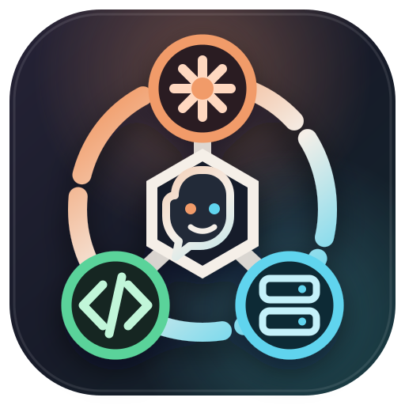

<div align="center">
  

  <h1>Model Bridge for Copilot</h1>

  <p><strong>Claude subscriptions, ChatGPT Codex, and local LM Studio models in native VS Code Chat.</strong></p>
</div>

Model Bridge for Copilot is a multi-provider VS Code Language Model Provider. It keeps the native Chat and Agent experience while letting you choose between a signed-in Claude Code account, ChatGPT Codex, and models running locally in LM Studio.

> This is an independent community extension. It is not affiliated with or endorsed by Anthropic, OpenAI, Microsoft, or LM Studio.

## Providers

| Provider | Authentication | Models and transport |
|---|---|---|
| **Claude** | Official Claude Code browser sign-in; no API key handled by the extension | Claude Default, Best, Fable, Sonnet, Opus, and Haiku through safe-mode `stream-json` |
| **Codex** | ChatGPT browser sign-in with multi-account support, stored in VS Code SecretStorage | Automatic Codex model discovery with HTTP/WebSocket Responses parity |
| **LM Studio** | No authentication by default; optional local server token in VS Code SecretStorage | Native model metadata plus OpenAI-compatible streaming chat and function tools |

Each provider has its own model-picker group and management command. Run **Model Bridge: Manage Providers** to open the unified entry point.

## Highlights

- Native VS Code Chat and Agent integration.
- Streaming text, thinking/reasoning, tool calls, and token usage.
- VS Code remains responsible for tool execution, confirmation, and workspace trust.
- Provider-specific model controls for reasoning effort, context size, temperature, and service tier.
- Matching Claude and Codex account-limit status bars (`Claude: 5h 74% · Weekly 65%`, `Codex: 5h 64% · Weekly 82%`) that refresh on startup, every 5 minutes, and after each request, with the latest request's token usage in the tooltip.
- The same Manage menu layout (Account, Usage, Models/Tools, Diagnostics) and Doctor report for every provider.
- Prompt-cache-friendly requests that conserve Claude and ChatGPT subscription limits during long agent sessions.
- Codex multi-account OAuth, automatic refresh, WebSocket reuse, continuation, hosted Web Search, and optional Native Tool Search.
- LM Studio native model metadata including loaded context, vision, tool-use training, architecture, size, and quantization.
- Safe diagnostics for every provider without logging prompts, responses, credentials, or tool contents.

## Quick start

### Claude

1. Install the official [Claude Code CLI](https://code.claude.com/docs/en/setup).
2. Run **Model Bridge: Claude: Sign in with Browser**.
3. Choose a model from the **Claude** group in VS Code Chat.

Claude account limits come from Claude Code's local `/usage` command, which makes no model request, and from the rate-limit events streamed with each response. Claude requests remove API-key environment variables, disable Claude Code built-in tools, use safe mode, and remove permission-restricted temporary prompt files after every request. By default the configured instructions and VS Code tool catalog replace Claude Code's coding-agent system prompt (`modelBridge.claude.systemPrompt`); VS Code Chat supplies its own agent instructions. Optional compatible session continuation is disabled by default because it causes Claude Code to retain local session history.

### Codex

1. Run **Model Bridge: Codex: Sign in with Browser**.
2. Complete the ChatGPT browser flow.
3. Run **Model Bridge: Codex: Test Connection**.
4. Choose a model from the **Codex** group.

Codex authentication is browser sign-in only in Model Bridge. API-key, device-code, and `auth.json` import commands are intentionally not exposed. The complete Codex transport is included: model discovery, Responses streaming, HTTP/WebSocket fallback, reasoning, VS Code tools, account usage, browser-signed-in multi-account selection, refresh-token rotation, and compatible response continuation.

### LM Studio

1. Install [LM Studio](https://lmstudio.ai/) and download or load a model.
2. Start the local server, normally on port `1234`.
3. Run **Model Bridge: LM Studio: Run Doctor**.
4. Run **Model Bridge: LM Studio: Test Connection**, then choose a model from the **LM Studio** group.

The default endpoint is `http://127.0.0.1:1234/v1`. Model Bridge uses native `GET /api/v1/models` for rich metadata and OpenAI-compatible `POST /v1/chat/completions` for VS Code function tools. If server authentication is enabled, use **Set API Token**; the token is stored only in VS Code SecretStorage.

## Unified management

Useful commands:

- `Model Bridge: Manage Providers`
- `Model Bridge: Open Provider Diagnostics`
- `Model Bridge: Claude: Run Doctor`
- `Model Bridge: Claude: Test Connection`
- `Model Bridge: Claude: Show Account Limits`
- `Model Bridge: Codex: Manage`
- `Model Bridge: Codex: Run Doctor`
- `Model Bridge: Codex: Test Connection`
- `Model Bridge: Codex: Show Account Limits`
- `Model Bridge: LM Studio: Run Doctor`
- `Model Bridge: LM Studio: Test Connection`
- `Model Bridge: LM Studio: Refresh Models`

Provider settings live under **Settings → Extensions → Model Bridge** and use these sections:

- `modelBridge.claude.*`
- `modelBridge.codex.*`
- `modelBridge.lmstudio.*`

### Upgrading from Anthropic for Copilot or Codex For Copilot

Settings under `anthropicForCopilot.*` and `codexModelProvider.*` are copied to the new sections on first activation. Credentials cannot be carried over because VS Code SecretStorage is scoped per extension, so run **Model Bridge: Codex: Sign in with Browser** again. Claude sign-in is owned by Claude Code and keeps working.

### Saving account usage

Claude and ChatGPT subscriptions are limited by tokens, and agent sessions resend the conversation with every tool call. Model Bridge keeps those requests cheap by default:

- **Claude:** history is sent as one content block per chat message, the system prompt and tool catalog stay byte-stable between requests (no cwd, environment, or git status sections; tools sorted, schema annotations removed), so each tool step reads the earlier conversation from the prompt cache instead of rewriting it.
- **Claude:** the default context size is 200K with a 32K output reservation, so Copilot summarizes long conversations instead of resending up to 1M tokens. Choose a larger **Context Size** in the model picker only when you need it.
- **Codex:** WebSocket continuation sends only new items with `previous_response_id`, and `prompt_cache_key` keeps each conversation on a warm cache. Keep `modelBridge.codex.transport` on `auto`; `http` replays the full history for tool results.

Further savings you can choose:

| Setting | Effect |
|---|---|
| Lower **Thinking Effort** / **Reasoning Effort** in the model picker | Fewer reasoning tokens, usually the largest share of output |
| `modelBridge.codex.textVerbosity`: `low` | Shorter Codex answers (some models accept only `medium`) |
| `modelBridge.codex.webSearchContextSize`: `low` | Less search context added to Codex requests |
| **Model Bridge: Codex: Enable Native Tool Search** | Codex loads tool schemas on demand instead of sending them all (see below) |
| `modelBridge.claude.sessionContinuation`: `true` | Resumes compatible Claude Code sessions; Claude Code then keeps local session history |

The Claude log (**Output → Model Bridge: Claude**) records input, cache-write, cache-read, and output token counts for every request, so you can check that cache reads dominate during agent sessions.

### Native Tool Search

**Model Bridge: Codex: Enable Native Tool Search** sets the global `github.copilot.chat.virtualTools.threshold` setting to `0`. That setting is shared by every chat model, so Claude, LM Studio, and Copilot models then receive the full tool list. Run **Model Bridge: Codex: Use VS Code Virtual Tool Groups** to restore the previous value, including before uninstalling the extension.

## Privacy and security

- Claude credentials remain owned by the official Claude Code CLI.
- ChatGPT OAuth and optional LM Studio tokens use VS Code SecretStorage.
- Local LM Studio prompts stay local unless the loaded model or LM Studio configuration routes them elsewhere.
- Provider logs contain only bounded diagnostics, counts, timings, model IDs, and sanitized errors.
- Claude Code built-in tools are disabled for hidden provider requests; selected tools execute through VS Code.
- Temporary Claude prompt files use restricted permissions and are always removed.

## Remote workspaces

The extension runs on the VS Code workspace host. For Remote-SSH, Dev Containers, WSL, and Codespaces:

- install and sign in to Claude Code on the remote host;
- make the LM Studio server reachable from that host and configure its URL;
- Codex credentials are stored on the host running the extension.

## Develop locally

```bash
npm install
npm run check
npm run compile
npm run test:smoke
npm run package:vsix
```

Press `F5` to launch an Extension Development Host. Release details are in [docs/releasing.md](docs/releasing.md).

## License and attribution

MIT. The Codex integration is derived from the MIT-licensed [Codex For Copilot](https://github.com/GaussianGuaicai/Codex-For-Copilot) project by Gaussian; the original copyright notice is retained in [LICENSE](LICENSE).
