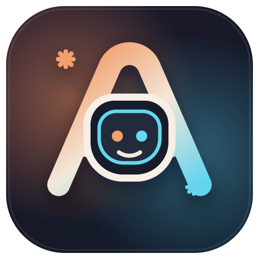

<div align="center">
  

  <h1>Anthropic for Copilot</h1>

  <p><strong>Use your signed-in Claude Code account in VS Code Chat and Agent mode.</strong></p>
</div>

Anthropic for Copilot is a VS Code Language Model Provider that connects the native VS Code Chat experience to the official Claude Code CLI. It does not ask for an Anthropic API key and does not copy, inspect, or store Claude credentials. Authentication remains owned by Claude Code.

> This is an independent community extension. It is not affiliated with or endorsed by Anthropic.

## Features

- Claude models appear in the native VS Code model picker.
- Uses the official Claude Code browser sign-in and locally stored session.
- Streams text and thinking from Claude Code's `stream-json` output.
- Forwards selected VS Code Agent tools through a constrained tool-call protocol; VS Code remains responsible for tool execution, confirmation, and workspace trust.
- Supports stable Claude Code model aliases: Default, Best, Fable, Sonnet, Opus, and Haiku.
- Adds model-picker controls for **Thinking Effort** (`Low` through `Maximum`) and **Context Size** (`100K` through `1M`).
- Streams request token usage back to VS Code and shows Claude's 5-hour and 7-day account utilization in the status bar.
- Includes **Doctor**, quick model configuration, Claude Code update, request timeout, structured limit/model/context errors, and forced cleanup of cancelled processes.
- Optionally resumes compatible Claude Code sessions for incremental follow-ups and better prompt-cache reuse.
- Supports required and automatic tool modes plus multiple independent VS Code tool calls.
- Never stores API keys or OAuth tokens in VS Code SecretStorage.

## Requirements

- VS Code 1.104.0 or newer.
- The official [Claude Code CLI](https://code.claude.com/docs/en/setup) installed on the same host where the extension runs.
- A Claude account or another authentication method supported by Claude Code.

Remote-SSH, Dev Containers, WSL, and Codespaces run workspace extensions remotely, so Claude Code must be installed and signed in on that remote host.

## Sign in

Open the Command Palette and use either command:

- **Anthropic for Copilot: Sign in with Browser** runs `claude auth login` in a VS Code terminal. This is the shortest route to Claude Code's official browser flow.
- **Anthropic for Copilot: Sign in with Claude Code** opens the interactive `claude` terminal. Claude Code starts its official setup flow when no account is signed in.

Both commands delegate authentication entirely to Claude Code. After login, run **Anthropic for Copilot: Refresh Models** or reopen the model picker.

Use **Anthropic for Copilot: Show Sign-In Status** to run `claude auth status`, or **Anthropic for Copilot: Sign Out** to run `claude auth logout`.

## Use Claude in Chat

1. Open VS Code Chat.
2. Open the model picker.
3. Choose **Claude** and then Default, Best, Fable, Sonnet, Opus, or Haiku.
4. Use the model options button to choose **Thinking Effort** and **Context Size** for the request.
5. Use Chat or Agent mode normally.

The status bar shows compact remaining account capacity such as `Claude 5h 75% · 7d 60%` after the first request. Hover it for remaining capacity and reset times, or click it for request token details. Claude Code emits these limits with model responses; there is no separate headless refresh endpoint, so values update whenever a request completes.

Each request runs Claude Code in non-interactive print mode with streamed JSON output and Claude Code's built-in tools disabled. Claude Code runs in safe mode so project/user customizations cannot alter provider requests while the normal saved Claude sign-in remains available. Selected VS Code tools are described explicitly to the model. This separation prevents the hidden CLI process from editing files or executing commands outside VS Code's normal tool confirmation flow.

Session persistence is disabled by default. Enabling `sessionContinuation` lets the provider send only appended turns to a compatible Claude Code session. Continuations are bounded, expire after 30 minutes, and are invalidated when model settings, instructions, tools, or schemas change. Claude Code stores opted-in sessions in its normal local history.

## Reliability and diagnostics

- **Anthropic for Copilot: Run Doctor** checks the executable, minimum version, sign-in method, subscription, workspace host, timeout, and continuation state without exposing credentials or prompts.
- **Anthropic for Copilot: Quick Configure Models** selects visible models plus default effort and context.
- **Anthropic for Copilot: Update Claude Code** runs the official `claude update` command.
- Requests time out after 10 minutes by default. Cancellation first requests graceful termination, then force-stops an unresponsive process.
- Authentication, rate-limit, unavailable-model, and context-limit failures are converted into actionable VS Code errors.

## Settings

- `anthropicForCopilot.claudePath`: executable name or absolute path, default `claude`. The native installer location `~/.local/bin/claude` is detected automatically even when it is missing from `PATH`.
- `anthropicForCopilot.model`: fallback Claude Code model alias, default `default`.
- `anthropicForCopilot.enabledModels`: model aliases visible in the model picker.
- `anthropicForCopilot.instructions`: instructions appended to every request.
- `anthropicForCopilot.defaultEffort`: default model-picker thinking effort.
- `anthropicForCopilot.defaultContextSize`: default `100K`, `200K`, `500K`, or `1M` auto-compact window.
- `anthropicForCopilot.usageStatusBar`: show or hide compact Claude account usage.
- `anthropicForCopilot.requestTimeoutSeconds`: request timeout from 30 to 3600 seconds.
- `anthropicForCopilot.sessionContinuation`: opt in to compatible Claude Code session reuse and local session history.
- `anthropicForCopilot.maxOutputTokens`: output capacity advertised to VS Code.

## Privacy and security

The extension sends the current VS Code Chat transcript and selected tool definitions to the local Claude Code process. Claude Code then communicates with Anthropic according to its own configuration and privacy terms.

The extension never reads Claude Code credential files, exports OAuth tokens, or accepts an Anthropic API key. It removes `ANTHROPIC_API_KEY`, `ANTHROPIC_AUTH_TOKEN`, and `CLAUDE_CODE_OAUTH_TOKEN` from provider and sign-in process environments so requests use Claude Code's own saved sign-in. It disables Claude Code's built-in tools for provider requests, removes temporary system-prompt files after each request, and logs only request metadata and output sizes rather than prompt or response content.

## Develop locally

```bash
npm install
npm run check
npm run compile
npm run test:smoke
npm run package:vsix
```

Press `F5` in VS Code to launch an Extension Development Host. Release packaging is documented in [docs/releasing.md](docs/releasing.md).

## License

MIT. This project is based on the MIT-licensed Codex For Copilot project; attribution is retained in [LICENSE](LICENSE).
